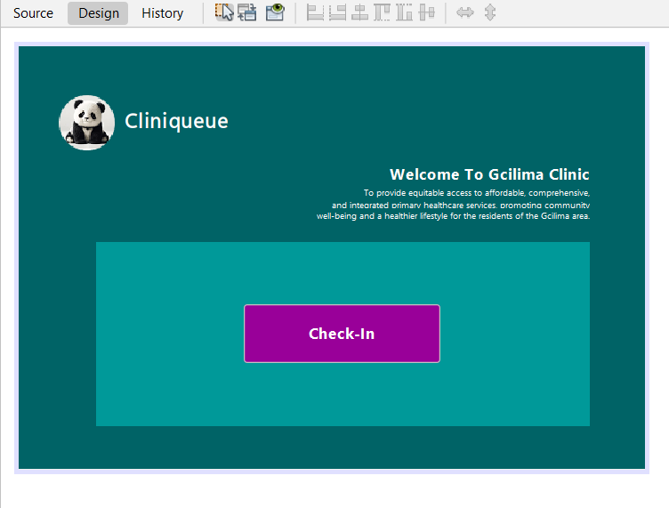

# CliniQueue

An offline queue management system for rural clinics, built with Java Swing and SQLite.

## Demo
[Watch the demo video](https://youtu.be/GqI43gAhr7c))

## The problem
Many rural clinics have long, unstructured queues, unreliable internet
and no wifi. Patients don't know when they will be seen, and staff have
no reliable record of who arrived first.

## The solution
CliniQueue is a kiosk-style desktop app that runs fully offline. A patient
checks in, registers, chooses their reason for visiting, and receives a
ticket with a queue number and room number. Tickets are saved in a local
database, so the queue is not lost if the power goes off.

## How it works
1. **Check-In:** the patient starts at the welcome screen.
2. **Register:** name, surname and ID number (13 digits), plus an optional file number.
3. **Reason for visit:** General Illness, Treatment or Chronic Med.
4. **Ticket:** General Illness tickets are numbered from saved records and stored in a local SQLite database.

See [docs/requirements.md](docs/requirements.md) for the full requirements and what is built so far.

## Screenshots

## Design decisions
- **Offline-first:** runs on one local computer with no internet needed.
- **Local SQLite database:** a single file with no server to install or
  maintain. Each ticket is written to the database immediately, so a
  power cut does not lose the queue.
- **Queue numbers from the database:** the next ticket number is based on
  the saved records, so numbering continues correctly after a restart.
- **Low-literacy users:** colour-coded buttons with icons and a simple flow.
- **Privacy (POPIA):** only the minimum details are collected, and the
  database file is kept off GitHub.
- **Secure database access:** uses prepared statements to protect against
  SQL injection.
- **Input validation:** required fields and a 13-digit ID check.

## Built with
Java, Swing, NetBeans, Maven, SQLite (JDBC)

## Future improvements
Staff screen to call the next patient
Save Chronic Med and Treatment tickets to the database
Show the file number on the Chronic Med ticket
Remaining treatment options and reasons for visit
Emergency fast-track
isiZulu language option
Ticket printing
