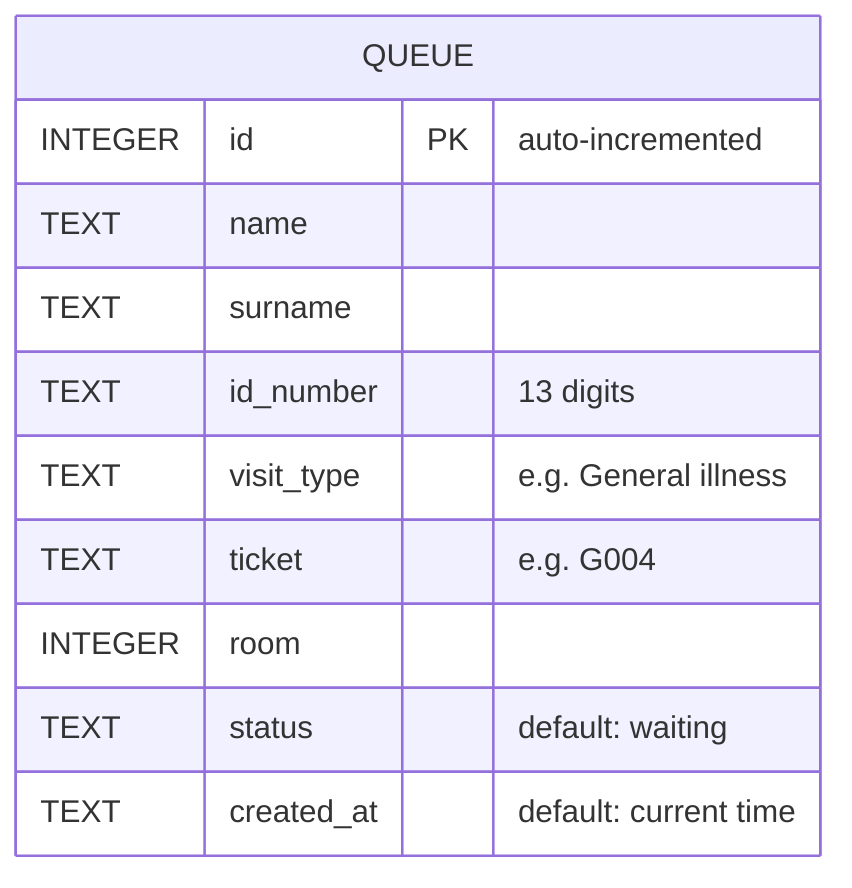

# CliniQueue: Database design

CliniQueue uses a local SQLite database file (`cliniqueue.db`). The file is created automatically the first time the app runs, and it is excluded from GitHub so no patient data is published.

## Entity relationship diagram

## Data dictionary

| Column | Type | Description |
|--------|------|-------------|
| id | INTEGER (primary key) | Unique row number, assigned automatically |
| name | TEXT | Patient first name |
| surname | TEXT | Patient surname |
| id_number | TEXT | 13-digit ID number, validated before saving |
| visit_type | TEXT | Reason for visit, e.g. General illness |
| ticket | TEXT | Queue number, e.g. G004 |
| room | INTEGER | Consultation room number |
| status | TEXT | Queue status, defaults to `waiting` |
| created_at | TEXT | Date and time the ticket was saved |

## How ticket numbers are generated
The next ticket number is based on the saved records. The app counts the tickets that already start with the prefix (for example `G`), adds 1, and formats the result with three digits, so the next General illness ticket after G034 is G035. Because the count comes from the database, numbering continues correctly after a restart or power cut.

## Design decisions
- **SQLite:** a single file with no server to install, which suits a clinic without reliable internet.
- **Prepared statements:** all inserts and queries use placeholders, which protects against SQL injection.
- **Immediate saving:** each ticket is written to the database as soon as it is created.

## Known limitations and planned changes
- The optional **file number** from the Register page is not stored yet. A `file_number` column would be added.
- Only General illness tickets are saved so far. Chronic Med and Treatment tickets are planned.
- ID numbers are stored as plain text. A production system would need encryption and access control to meet POPIA requirements.
- The `status` column is ready for a staff screen, which will change a ticket from `waiting` to `called` or `seen`.
